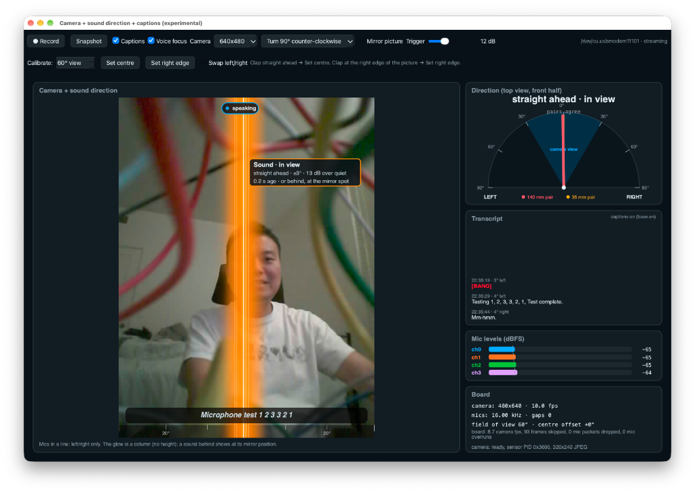
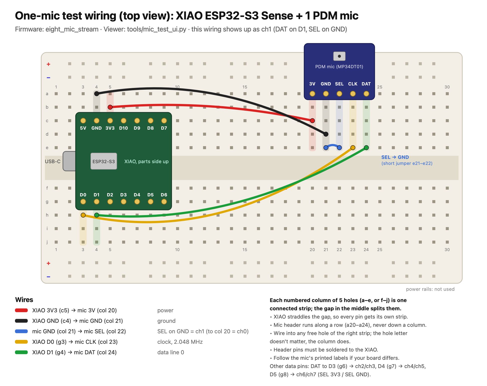
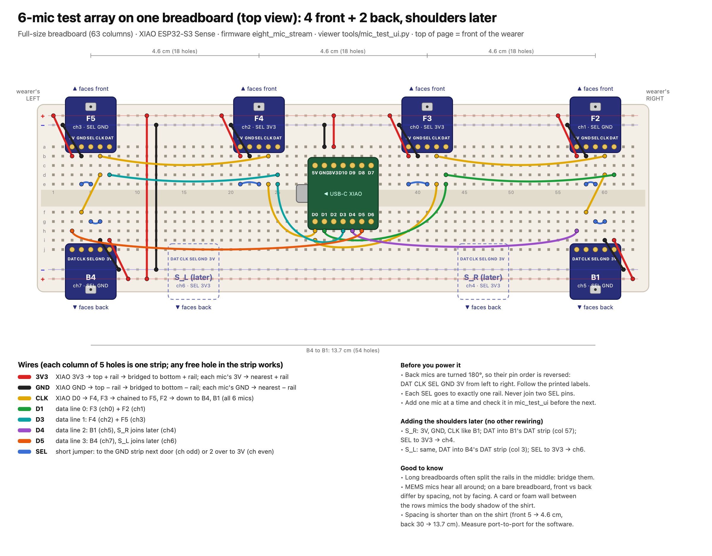

# Wearable mic array: sound direction, voice focus and offline captions

A wearable microphone array built around one **Seeed XIAO ESP32-S3 Sense**. PDM MEMS mics
and the board's camera stream to a laptop, which works out where sounds come from, shows
that direction on the live video, pulls the wearer's or a talker's voice out of background
noise, and writes live captions, all without the internet.

It started as a 2-mic bench rig, is working today with 4 mics and a camera, and is being
grown to an 8-mic array around the torso for full 360° direction finding.



## What I built

**Firmware (ESP32-S3, Arduino core + ESP-IDF drivers, FreeRTOS)**
- PDM capture of up to 8 mics on one shared clock and 4 data lines (I2S0), 16 kHz per channel.
- Audio and camera share one USB-C link with a small packet protocol; the mics always win, so audio is never dropped.
- Audio on its own core at top priority; camera, SD card and the record button on the other.
- Record button: 1 press records voice, 2 presses record voice + video to microSD, buffered through PSRAM so slow card writes never cost audio.
- Bring-up sketches for finding pins, checking wiring and testing one mic at a time.

**Laptop apps (Python, numpy, PySide6)**
- **Sound direction:** GCC-PHAT time delays between mic pairs; for the 2-D array, SRP-PHAT over every mic pair for a full 360° answer, including whether a sound is in front or behind.
- **Camera overlay:** a glow where the sound is in the picture, or an arrow at the edge (or "behind you") when it's out of frame; two-clap calibration.
- **Voice focus:** an MVDR beam toward the talker plus a Wiener hiss filter.
- **Offline captions:** Whisper (`faster-whisper`) on the laptop CPU, with each caption placed by who's talking.
- **SD take pipeline:** import a recording, compute directions, voice focus, transcript and MP4, then review it in a take viewer.
- **Bench tools:** a live one-mic tester, 8-channel capture with dead/stuck-line detection, and generated breadboard wiring diagrams.

**Tablet / phone app (browser, no install)**: [open it](https://moonx02.github.io/wearable-mic-array/app/)
- Plug the board into an Android tablet's USB-C port and open the page in Chrome: it reads the same USB stream (WebUSB / Web Serial) and runs the 360° SRP-PHAT direction finder in JavaScript.
- Camera with the direction glow and edge arrows, 360° radar, mic levels, two-clap calibration.
- **Subtitles from the array, fully offline:** the same voice focus as the laptop app (MVDR beam + Wiener filter, ported to JavaScript and checked against the Python: correlation 0.9999) feeds an on-device recogniser ([Vosk](https://github.com/alphacep/vosk-api) in WebAssembly, small English model). Words appear while the talker speaks; each line is placed by the talker's direction, measured over exactly the time span of its words.
- After the first visit it needs no internet at all (the page, recogniser and model are kept on the device), and nothing leaves the tablet.
- Works without a board too: tap **Demo** for recorded speech and claps from around the array over a fan. Source: [`docs/app/`](docs/app/).

**HUD prototype**: a heads-up display design run on a simulated 8-mic recording
(room acoustics simulation, SRP-PHAT radar, steerable MVDR beam), with a standalone
browser version. See [`hud/`](hud/).

## Results so far

| Measurement | Result |
|---|---|
| Voice focus against a fan (levels 2–4) | voice-to-background up by **+20 to +34 dB** |
| Lost audio frames, 9 recorded test takes | **0** |
| Camera while streaming 4 mics | 10 fps at 320×240, 0 mic packets lost |
| 8-channel firmware + camera over USB | about 305 kB/s, about 10 fps, 0 drops |
| Captions (Whisper `base.en`, Apple M2) | 13.8 s of audio in 0.6 s; captions 1–2 s behind speech |
| 360° direction, simulated 5-mic array | worst error 1°, front/back separated |

Details, method and before/after spectrograms: [`esp32s3/README.md`](esp32s3/README.md#measured-results).

## Roadmap: from 4 mics to 8

- [x] **2-mic bench rig**: left/right direction from one mic pair.
- [x] **4 mics + camera**: direction overlay on video, voice focus, live captions.
- [x] **Recording**: button-triggered microSD takes and the laptop processing pipeline.
- [x] **8-channel firmware** on the vest pinout (clock D0; data D1, D3, D4, D5) with camera and SD.
- [x] **Mic bring-up tooling**: tap-test each mic, catch dead or stuck data lines.
- [ ] **Now: 5-mic 2-D array** (4 front + 1 rear centre) with the 360° app, validating directions and calibration on real hardware.
- [ ] **6 mics**: replace the two faulty mics, giving 4 front + 2 back.
- [ ] **8 mics**: add the two shoulder mics ([wiring](docs/planning/eight-mic-wiring.md)), measure the real mic positions, calibrate per-mic delays.
- [ ] **Voice focus and captions on the full array**, steering the beam in 360°.
- [x] **Tablet display**: the 360° view in Chrome on an Android tablet over USB, instead of a laptop.
- [ ] **Untethered**: Wi-Fi audio/take upload, battery power, vest firmware tasks (beam, loud-event alerts, push-to-talk) from [`vest_rtos_skeleton`](esp32s3/vest_rtos_skeleton/vest_rtos_skeleton.ino).
- [ ] **On the vest**: harness, enclosure, and the HUD running on real recordings.

## Repository layout

| Path | What's there |
|---|---|
| [`esp32s3/`](esp32s3/) | Firmware sketches, laptop apps, tools, wiring diagrams, full write-up |
| [`esp32s3/CAMERA_AND_CAPTIONS.md`](esp32s3/CAMERA_AND_CAPTIONS.md) | Firmware flow, USB packet format, offline proof |
| [`hud/`](hud/) | HUD prototype and the 8-mic simulation |
| [`docs/app/`](docs/app/) | Browser app for an Android tablet over USB ([live](https://moonx02.github.io/wearable-mic-array/app/)) |
| [`docs/planning/`](docs/planning/) | 8-mic wiring plan, array layout study, accuracy study |

## Hardware

- Seeed XIAO ESP32-S3 Sense (8 MB PSRAM, OV3660 camera, microSD)
- PDM MEMS mic breakouts (MP34DT01-class), two per data line, SEL picks the left or right slot
- Parts list: [`esp32s3/BOM.md`](esp32s3/BOM.md)

| Stage | Wiring |
|---|---|
| Single-mic test |  |
| 6-mic breadboard array |  |

## Running it

Firmware (Arduino ESP32 core, `arduino-cli`):

```bash
cd esp32s3
FQBN=esp32:esp32:XIAO_ESP32S3:PSRAM=opi,CDCOnBoot=cdc
arduino-cli compile --fqbn $FQBN cam_mic_record8
arduino-cli upload  --fqbn $FQBN -p <port> cam_mic_record8
```

Laptop (Python 3 with numpy, pyserial and PySide6):

```bash
cd esp32s3
python3 mic_camera_view360.py --geometry array_5mic_rear_centre.json   # 360° direction + camera
python3 mic_camera_view360.py --demo                                   # no board needed
python3 mic_caption_view.py                                            # 4-mic voice focus + captions
```

Tablet: plug the board into an Android tablet, open
<https://moonx02.github.io/wearable-mic-array/app/> in Chrome, tap **Connect USB** and pick the board.
The first visit downloads the 41 MB speech model; after that it works offline.
Bundled: `vosk-browser` 0.0.8 and `vosk-model-small-en-us-0.15` (both Apache-2.0).

More options, calibration and the 4-mic setup are in [`esp32s3/README.md`](esp32s3/README.md#running-it).
