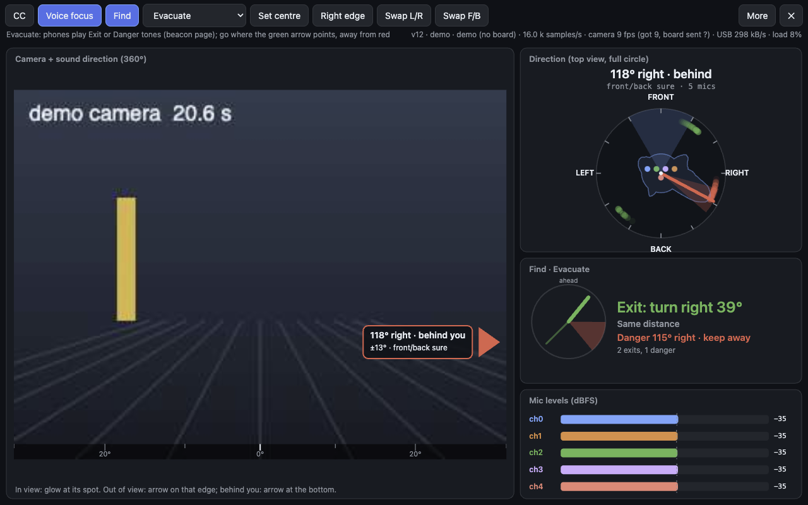
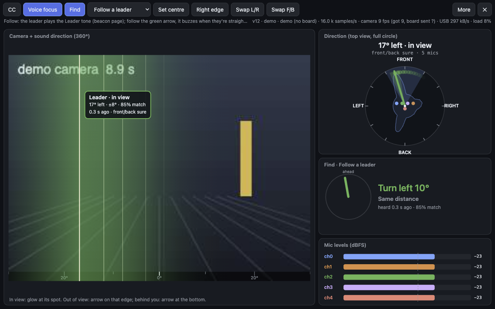
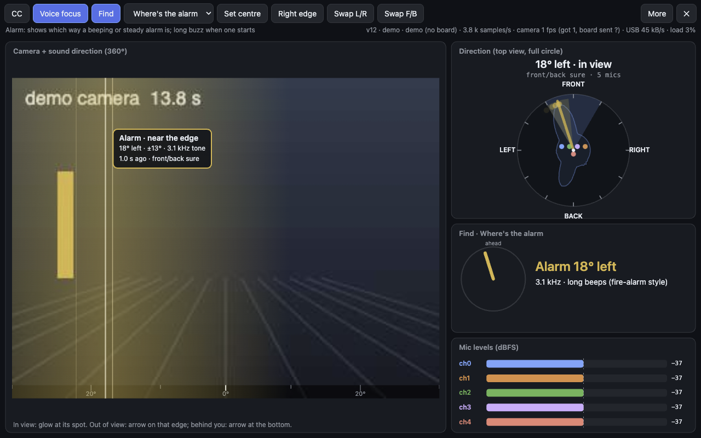
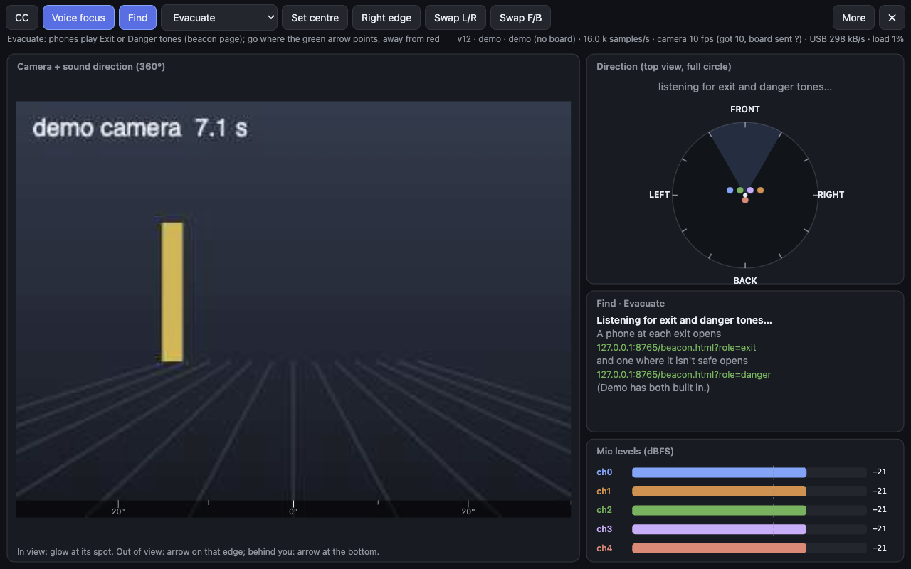
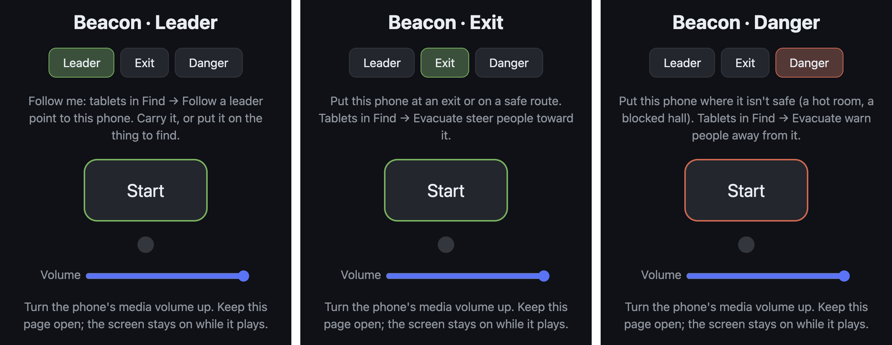
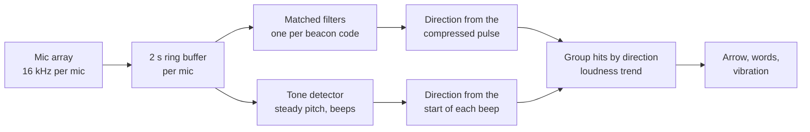
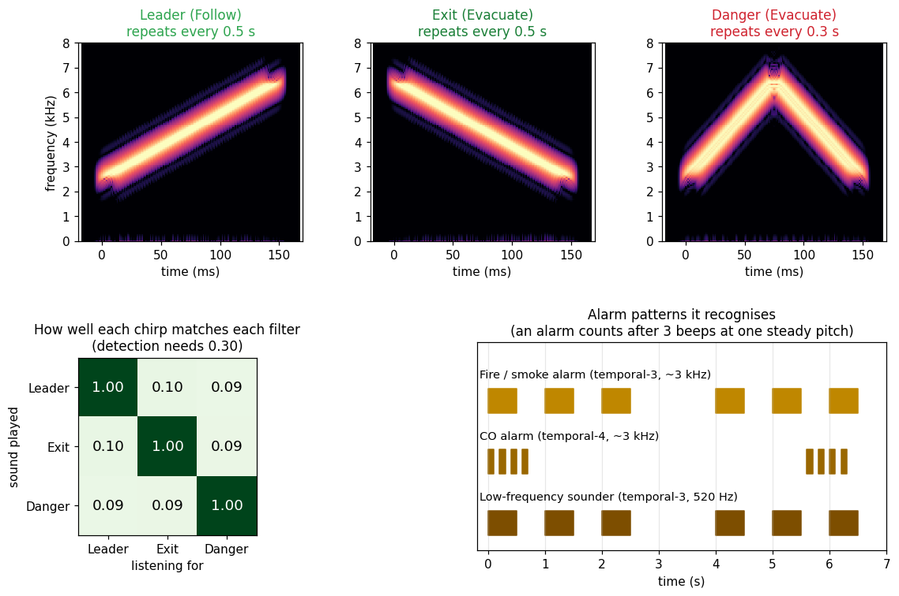

# Find mode: follow a leader, find an alarm, evacuate

Find mode turns the wearable mic array into a sound compass. Instead of captions, the tablet
points to particular sounds: a leader's phone, a smoke or fire alarm, or "breadcrumb" beacons
that mark exits and dangers during an evacuation. It shows which way to turn on screen and
with vibration, so it also works for someone who can't hear the sound at all.

- [Why](#why)
- [Quick start](#quick-start)
- [The three functions](#the-three-functions)
  - [Follow a leader](#follow-a-leader)
  - [Where's the alarm](#wheres-the-alarm)
  - [Evacuate](#evacuate)
- [The beacon page](#the-beacon-page)
- [Trying it without hardware (Demo)](#trying-it-without-hardware-demo)
- [How it works](#how-it-works)
- [Test results](#test-results)
- [Limits and next steps](#limits-and-next-steps)
- [Showing it in a demo](#showing-it-in-a-demo)

## Why

The array already knows where sounds come from. That is most useful when the sound carries
meaning and the wearer can't hear it or can't tell where it is:

- **Deaf and hard-of-hearing users** often can't hear an alarm, and even a hearing person can't
  tell where a beeping alarm is in a large, echoing space.
- **Groups moving through smoke, darkness or crowds** need to follow one person without seeing them.
- **Evacuations**: our professor suggested acoustic *breadcrumbs*, sounds placed along a route
  that people can follow out. Find mode extends that: an exit plays one sound, and a dangerous
  area (a hot room, a blocked hall) plays a different one, so the tablet can steer people toward
  safety and away from danger at the same time.

Turning Find on switches captions off and unloads both speech models, which frees their memory
and CPU for the direction finding.

## Quick start

1. Open the app on the tablet: <https://moonx02.github.io/wearable-mic-array/app/>. Connect
   the board over USB (or tap **Demo**). The status line should start with **v13** or later.
2. Tap **Find**. A menu appears next to it. Pick **Follow a leader**, **Where's the alarm** or
   **Evacuate**.
3. For Follow and Evacuate, open the beacon page on other phones (links below), turn the media
   volume up, and tap **Start**. The alarm finder needs no beacons; it listens for real alarms.
4. Follow the arrow in the **Find** panel. Feel for the buzzes (Android tablets and phones).

| Beacon role | Link to open on the phone |
|---|---|
| Leader | <https://moonx02.github.io/wearable-mic-array/app/beacon.html?role=leader> |
| Exit | <https://moonx02.github.io/wearable-mic-array/app/beacon.html?role=exit> |
| Danger | <https://moonx02.github.io/wearable-mic-array/app/beacon.html?role=danger> |

Tip: print these links as QR codes and stick them on the phones you use as beacons.

## The three functions

The screen layout is the same in all three. The **camera** view shows a glow where the sound is
when it's in the picture, or an arrow on the edge when it isn't. The **radar** (top right) shows
the full circle around the wearer. The **Find** panel (middle right) gives the instruction in
words. Colours: green for the leader and exits, red for dangers, yellow for alarms.

### Follow a leader

The leader carries a phone with the **Leader** beacon playing (a rising chirp twice a second).
Everyone else follows the green arrow.

- **Find panel:** "Turn left 10°", "Straight ahead" or "Behind you". Under it, "Getting closer"
  or "Getting farther" (from the beacon getting louder or quieter), how long ago it was heard,
  and how well it matched the beacon sound.
- **Lost them:** if the beacon hasn't been heard for 2 s the arrow greys out and shows where it
  was last heard.
- **Buzz:** a short tap each time the leader is heard within 12° of straight ahead, so you can
  walk toward them without watching the screen.

The same beacon also works for finding a thing: put the phone on it and use the tablet as a
"hot and cold" finder.

### Where's the alarm

No beacons needed. The tablet listens for smoke, fire and carbon-monoxide alarms: loud, steady
tones (400 Hz to 4.5 kHz) that beep on and off or sound continuously.

- **Find panel:** "Alarm 18° left", its pitch, and its beep style: "long beeps (fire-alarm
  style)", "short beeps (CO-alarm style)" or "steady tone". It also says whether the alarm is
  getting louder (you're getting closer), and if more than one alarm is heard.
- **Buzz:** a long double buzz when an alarm starts (once, then again only if it stopped for 15 s).
- **No false alarms from talk:** a beep only counts if it holds one unwavering pitch and comes
  three times at that pitch within 10 s (or sounds continuously for 1.5 s). Voices slide in pitch,
  so talk, whistling and singing don't set it off. The cost is a delay of a second or two before
  the first alarm shows.

To try it at home, press the test button on a smoke alarm.

### Evacuate

Phones at the exits play the **Exit** beacon (a falling chirp). Phones where it isn't safe
play the **Danger** beacon (an up-and-down chirp, repeated faster so it also sounds urgent to
people who can hear it). The tablet guides toward the best exit and warns away from dangers.

- **Find panel:** "Exit: turn right 39°" in green, "Danger 115° right · keep away" in red, and
  how many exits and dangers it hears. The small dial shows every exit (thin green lines), the
  chosen exit (thick green arrow) and each danger as a red keep-away wedge.
- **Choosing the exit:** of the exits it hears, it picks the loudest (usually the nearest) one
  that is **not** in the same direction as a danger (within 35°), since that exit may be past the
  danger. If every exit is in line with a danger it says "Exit is past the danger" so the wearer
  knows to find another way.
- **Several exits:** two phones playing Exit are shown separately, even at the same loudness.
- **Buzz:** a short tap when an exit is straight ahead; a double buzz when you face a danger
  (the danger buzz wins if both are ahead).

Before any beacon is heard, the panel shows which links to open on the beacon phones:

(Screenshots were taken on a local test server, so the links show `127.0.0.1`; on the live site
they show the `moonx02.github.io` address.)

## The beacon page

Any phone with a browser becomes a beacon: open the page, pick a role, tap **Start**. The page
keeps the screen on while it plays, and the dot flashes with each chirp.

- Use the media volume at or near maximum. A phone speaker carries across a room; in a large
  hall, a small Bluetooth speaker on the phone carries much farther.
- The role can be changed while it's playing. The link in the address bar updates, so you can
  bookmark or share it.
- After the first visit the page works offline.

## Trying it without hardware (Demo)

Tap **Demo** on the app's start screen, then **Find**. Each function has its own simulated
scene, mixed with recorded talkers and claps from around the array and a fan behind:

| Function | What the demo plays |
|---|---|
| Follow a leader | A leader circling the wearer and walking nearer and farther |
| Where's the alarm | A 3.1 kHz fire alarm in the temporal-3 pattern (three 0.5 s beeps, pause) |
| Evacuate | Two exits (one loud, one quiet, behind) and a danger |

In all three the simulated wearer turns slowly, so the arrows move the way they would if you
turned in place.

## How it works

### The beacon sounds

All three beacons are 150 ms chirps that sweep between 2.5 and 6.5 kHz, each with a different
shape. That band is loud on phone speakers, well above most of a voice's energy and a fan's
rumble, and within what the mics record.

The tablet runs one **matched filter** per beacon: it slides the expected chirp along the
recording and measures how closely each moment matches, from 0 (nothing alike) to 1 (identical).
A hit needs 0.30. As the matrix shows, each chirp matches its own filter perfectly and the other
two at only about 0.10, so the tablet never mistakes an exit for a danger, even when both play at
once. Voices, fans and claps stay well under 0.30 (no false hits in testing), and an alarm tone
matches at 0.12 or less.

### Direction

- **Beacons:** the matched filter squeezes the 150 ms chirp into a pulse a quarter of a
  millisecond wide. The direction is worked out from a few milliseconds around that pulse on each
  mic (SRP-PHAT over every mic pair, the same method the app uses for any sound, restricted to the
  chirp's band), so almost none of the background noise gets in. Echoes arrive later, and within
  50 ms only the strongest copy is kept.
- **Alarms:** each frame (64 ms, every 16 ms) is checked for one frequency standing far above the
  rest of the band. A run of those at one pitch is a beep. When a beep ends, its direction comes
  from its first ~150 ms, before the room's echoes build up, using only the frequencies right
  around the tone.
- **Loudness:** each beacon's loudness is measured from its own chirp (how strongly it matched),
  not from everything in that moment, so a different sound overlapping it doesn't make it seem
  closer. "Getting closer" means at least 2.5 dB louder than a few seconds earlier.
- **Grouping:** hits are grouped by direction (within 25°), so two exits show as two. Each
  group's direction is the average of its last few hits.

### Vibration patterns

| Pattern | Meaning |
|---|---|
| Short tap | The leader, or an exit, is straight ahead |
| Two short buzzes | You're facing a danger |
| Two long buzzes | An alarm has started |

## Test results

Measured in a headless simulation of the array: each sound arrives at every mic with the right
delay for its direction, over a pink-noise fan and recorded talkers, on both the 5-mic layout
(4 front + rear centre) and the 4-front-mic layout.

| Test | Result |
|---|---|
| Leader, exit and danger direction (loud to quiet) | within **0–4°** |
| Exit and danger playing at the same time | both found, within 0–4° |
| Two exits with the same sound, 110° apart | both shown, nothing in between |
| A beacon mistaken for a different beacon | **never** |
| Fire alarm (temporal-3, 3.1 kHz), loud and quiet | within 1–3°, "long beeps (fire-alarm style)" |
| Low-frequency sounder (520 Hz) | median 2°, worst 13° (its long wavelength makes it the hardest) |
| CO alarm (temporal-4, 0.1 s beeps) | within 0–1°, "short beeps (CO-alarm style)" |
| 20 s of fan and talking only | **0** false beacons, **0** false alarms |
| Beacon page chirps vs. the tablet's filters | identical, sample for sample |

The demo was also run in the browser: in each function the tablet's directions followed the
simulated sources as the wearer turned.

## Limits and next steps

- **Not yet tested with real phones, a real alarm, or the vest.** Real rooms add echoes and real
  phone speakers aren't perfect, so expect somewhat larger errors than the simulation.
- **Front and back.** With only the 4 front mics, a sound behind looks the same as one in front;
  the panel says "no back mic: could also be behind". For evacuation the rear mic matters most.
- **Direction, not a route.** Sound bends around corners, so the arrow points to where the sound
  enters your space (often a doorway). That's usually the right next step, but it isn't a map.
- **Distance** is only "closer / farther" from loudness.
- **Alarms that sweep in pitch** (whooping sirens) aren't recognised yet; nor is the first beep,
  by design.
- **Dangers are only where beacons are placed.** The tablet doesn't sense heat or smoke itself;
  in a real building the alarm system would have to play these sounds.

Ideas for next steps:

- Run the alarm finder quietly in the background while captions are on, and alert a deaf wearer
  whenever an alarm starts.
- Breadcrumb trails: numbered beacons along a route (more chirp shapes), with "next crumb"
  guidance and automatic arrival detection.
- Small dedicated beacons (a microcontroller, a speaker and a battery) instead of phones.

## Showing it in a demo

A short script for presenting Find mode with three phones:

1. Show captions working, then tap **Find**: captions switch off and the speech models unload.
2. **Follow:** one person walks around the room with the Leader phone; the wearer turns to follow
   the arrow and feels the tap when facing them.
3. **Alarm:** press a smoke alarm's test button (or play a fire-alarm recording) somewhere in
   the room; the tablet buzzes and points to it.
4. **Evacuate:** put an Exit phone by the door and a Danger phone in a corner. The tablet points
   to the door and marks the corner red. Move the Danger phone in front of the door: the panel
   changes to "Exit is past the danger".
