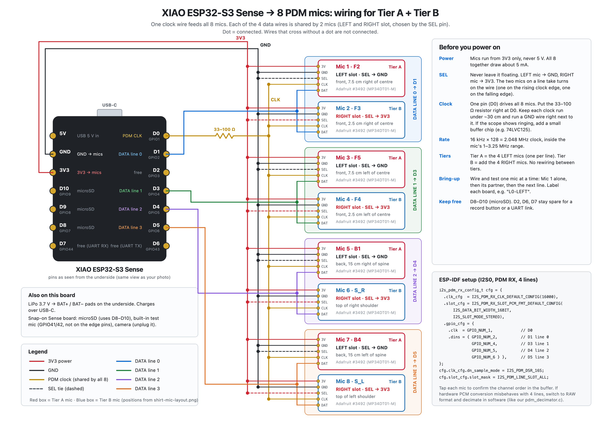

# XIAO ESP32-S3 Sense: 8-mic vest wiring

The target wiring for the full 8-mic vest array on one XIAO ESP32-S3 Sense
(firmware: [`eight_mic_stream`](../../esp32s3/eight_mic_stream/eight_mic_stream.ino) and
[`cam_mic_record8`](../../esp32s3/cam_mic_record8/cam_mic_record8.ino)).

## Wiring

Files: [`esp32s3-mic-wiring.png`](esp32s3-mic-wiring.png) · [`esp32s3-mic-wiring.svg`](esp32s3-mic-wiring.svg)

| XIAO pin | GPIO | Goes to |
|---|---|---|
| D0 | 1 | PDM clock → CLK on all 8 mics (through a 33–100 Ω resistor at the pin) |
| D1 | 2 | Data line 0 → DAT of Mic 1 (F2) and Mic 2 (F3) |
| D3 | 4 | Data line 1 → DAT of Mic 3 (F5) and Mic 4 (F4) |
| D4 | 5 | Data line 2 → DAT of Mic 5 (B1) and Mic 6 (S_R) |
| D5 | 6 | Data line 3 → DAT of Mic 7 (B4) and Mic 8 (S_L) |
| 3V3 | – | 3V on all mics; SEL on the 4 RIGHT-slot mics |
| GND | – | GND on all mics; SEL on the 4 LEFT-slot mics |
| D2, D6, D7 | 3, 43, 44 | Spare (record button, UART) |
| D8–D10 | 7–9 | Taken by the Sense board's microSD slot |

The 4-mic bench firmware (`four_mic_stream`, `cam_mic_stream`) clocks D1 and reads D0
instead; everything from `cam_mic_record_array4` on uses this table.

- Tier A is the 4 LEFT-slot mics (F2, F5, B1, B4), one per data line. Tier B adds the 4 RIGHT-slot mics (F3, F4, S_R, S_L) with no rewiring.
- Clock: 16 kHz × 128 = 2.048 MHz (`I2S_PDM_DSR_16S`), inside the MP34DT01's 1–3.25 MHz range.
- ESP32-S3 PDM receive (I2S0) supports up to 4 data lines / 8 mics on one shared clock ([ESP-IDF I2S docs](https://docs.espressif.com/projects/esp-idf/en/stable/esp32s3/api-reference/peripherals/i2s.html)).
- Keep clock runs short (under ~30 cm) with a GND wire alongside. Add a buffer chip if the clock edge rings on the scope.

## Getting the audio off the board

| Link | Carries | Rate | Use |
|---|---|---|---|
| USB-C (serial) | 8 raw channels | 2.05 Mbit/s | Bench work (working today) |
| Wi-Fi (UDP) | 8 raw channels | 2.05 Mbit/s | Live, untethered (planned) |
| microSD | 8-channel WAV | ≈0.9 GB/hour | Field recordings, copied later (working today) |
| Bluetooth LE | Start/stop, battery, level | small | Control only (planned) |

One board's 8 mics form one array. Audio from two boards can't be combined into one beam,
because each board has its own clock.
