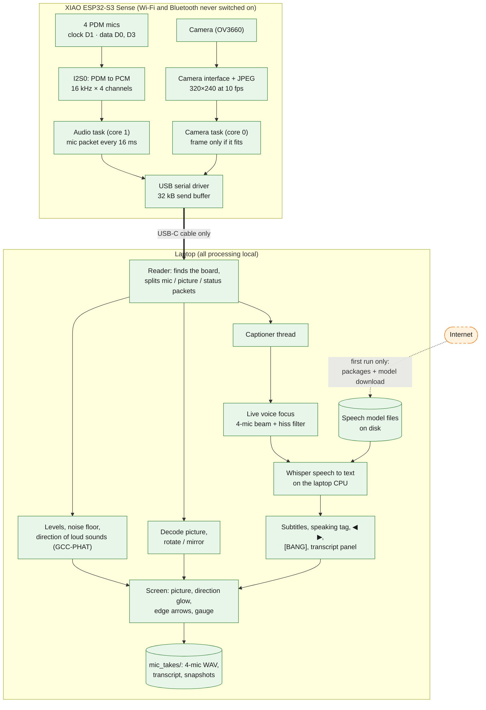
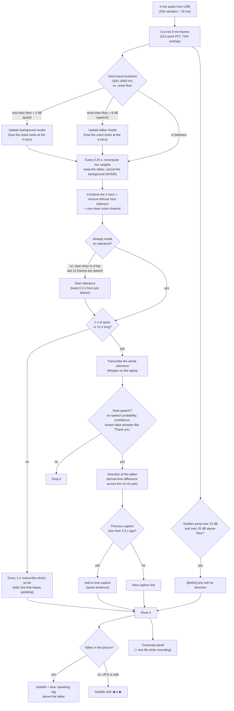
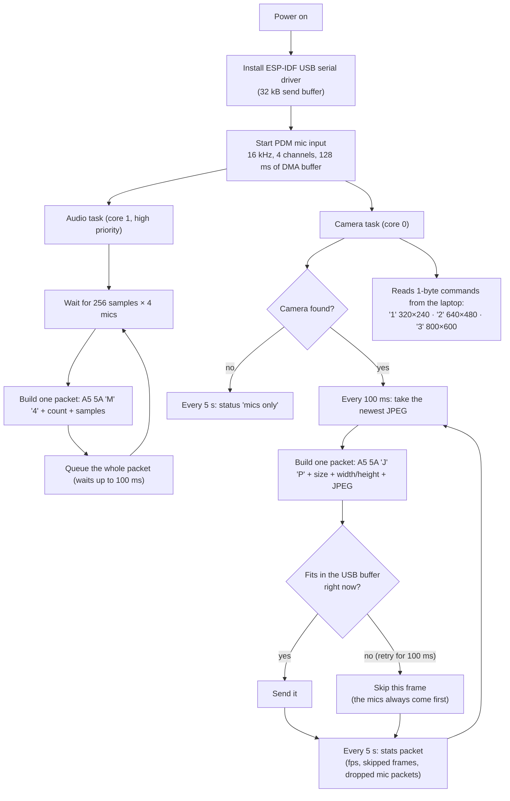
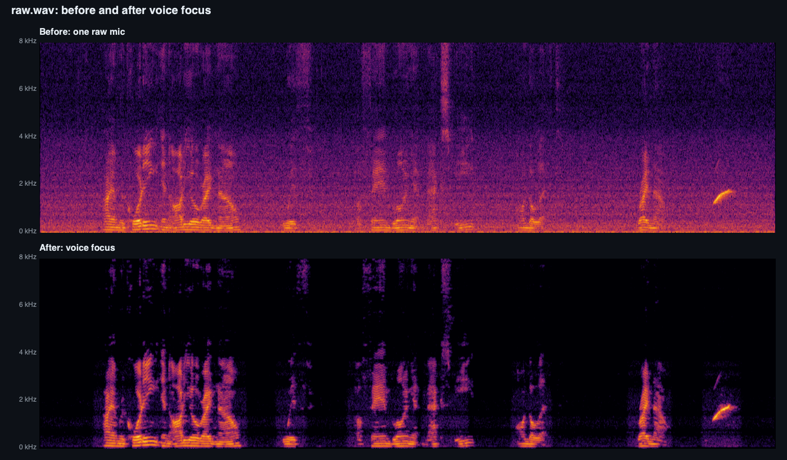

# Camera, sound direction and live captions (fully offline)

For how each part works step by step (sound location, overlay, voice focus, captions),
start with the [README](README.md). This page covers the firmware, packet format and
the offline proof.

The XIAO ESP32-S3 Sense streams its 4 PDM mics and its camera to a laptop over one
USB cable. The laptop shows the camera picture with where each sound comes from,
cleans up the voice, and writes live captions placed next to whoever is talking.

**Everything runs on the board and the laptop. Nothing is sent over the internet.**
The internet is used once, on a new computer, to install the Python packages and
download the speech model. After that the whole system works with Wi-Fi switched off.


## Contents

- [What's in this folder](#whats-in-this-folder)
- [Why it is offline](#why-it-is-offline)
- [Flow chart 1: the whole system](#flow-chart-1-the-whole-system)
- [Flow chart 2: from sound to caption](#flow-chart-2-from-sound-to-caption)
- [Flow chart 3: the firmware](#flow-chart-3-the-firmware)
- [How each part works](#how-each-part-works)
- [Measured results](#measured-results)
- [Running it](#running-it)
- [Limits](#limits)

## What's in this folder

| File | What it is |
|---|---|
| `cam_mic_stream/cam_mic_stream.ino` | Board firmware: 4 mics + camera over USB |
| `mic_camera_view.py` | Camera view: picture, sound direction glow, off-screen arrows |
| `mic_caption_view.py` | Camera view + live voice focus + live captions (experimental) |
| `tools/voice_focus.py` | Cleans a saved recording down to the voice |

The camera view (`mic_camera_view.py`) is the stable version (git tag `camera-view-v1`).
The captions viewer builds on it without changing it, and installs its packages in its
own folder (`~/.mic-caption-env`), so it can't break the camera view.

## Why it is offline

| Part | Runs on | Network use |
|---|---|---|
| Mics, camera, firmware | ESP32-S3 | None. The firmware never starts Wi-Fi or Bluetooth; data leaves only over the USB cable. |
| Sound direction, overlay | Laptop | None |
| Voice focus (noise removal) | Laptop | None. Plain math (numpy), no model, no service. |
| Speech to text | Laptop CPU | None after setup. Whisper (`faster-whisper`, model `base.en`, 8-bit) is loaded from disk with `local_files_only=True`; it only downloads if the model isn't on disk yet. Hugging Face telemetry is switched off. |
| Silence detection inside Whisper | Laptop | None. The Silero VAD model ships inside the `faster-whisper` package. |
| Recordings, transcripts, snapshots | Laptop disk (`mic_takes/`) | None |

**Checked:** while the captions viewer was running and transcribing, `lsof -i` listed
**no network sockets** for either of its processes, and the speech model loaded with
`HF_HUB_OFFLINE=1` (internet access forbidden) in 0.6 s.

**Try it yourself:** turn Wi-Fi off, plug in the board, run `python3 mic_caption_view.py`
and talk. Captions still appear.

**One-time setup that does need internet** (on each new computer):

1. `pip` installs `numpy`, `PySide6`, `pyserial` and `faster-whisper` into `~/.mic-caption-env`.
2. The speech model is downloaded from Hugging Face into `~/.cache/huggingface/`
   (about 150 MB for `base.en`, 500 MB for `small.en`).

## Flow chart 1: the whole system

PNG copies of the three charts for slides: [`docs/flow_system.png`](docs/flow_system.png),
[`docs/flow_captions.png`](docs/flow_captions.png), [`docs/flow_firmware.png`](docs/flow_firmware.png).



Green boxes run with no internet at all. The orange dashed link happens only once, during setup.

## Flow chart 2: from sound to caption

Runs on every 8 ms slice of audio, in its own thread on the laptop.



## Flow chart 3: the firmware



## How each part works

### Firmware (`cam_mic_stream.ino`)

- **Mics:** same wiring as `four_mic_stream`. One PDM clock on D1; data line 0 on D0 is
  the 140 mm pair (ch0/ch1) and data line 1 on D3 is the 35 mm pair (ch2/ch3). The S3's
  I2S0 converts PDM to 16-bit PCM at 16 kHz.
- **Camera:** the Sense board's OV3660 on its own connector, through the S3's camera
  interface. It doesn't share any pins with the mics. Frames are JPEG in PSRAM.
- **USB:** one cable carries both. The mics use 128 kB/s; the camera gets what's left
  (about 10 fps at 320×240, 7 fps at 640×480).
- **Why ESP-IDF's USB driver:** Arduino's built-in USB serial loses bytes under this much
  traffic (we measured a quarter of the frames arriving broken). ESP-IDF's driver queues
  each packet whole or not at all, and nothing was lost in testing. Because of this the
  sketch has to be built with "USB CDC On Boot" disabled:

  ```
  arduino-cli compile --fqbn esp32:esp32:XIAO_ESP32S3:PSRAM=opi,CDCOnBoot=cdc cam_mic_stream
  ```

- **Packets** (little-endian, each starts with `A5 5A`):

  | Type | Layout |
  |---|---|
  | `M4` mics | `uint32 seq, uint16 frames, frames × 4 × int16` |
  | `JP` picture | `uint32 seq, uint32 length, uint16 width, uint16 height, JPEG` |
  | `ST` status | `uint16 length, text` |

  The mic packet is the same as `four_mic_stream`, so the older viewers and capture
  scripts still work with this firmware.

### Sound direction and overlay (`mic_camera_view.py`)

- **Direction:** for each loud sound, GCC-PHAT finds the arrival-time difference across
  each mic pair (300–6000 Hz). Angle = asin(delay × 343 m/s ÷ spacing). The 140 mm pair
  gives about ±3° straight ahead; the 35 mm pair is a cross-check.
- **Placing it on the picture:** x = centre − f·tan(angle), with f = (picture width / 2) /
  tan(field of view / 2). Inside the field of view it's a glowing column; outside, an
  arrow on that edge ("off screen · ~70° left").
- **Calibration:** clap straight ahead → "Set centre"; clap at the right edge of the
  picture → "Set right edge" (this measures the camera's field of view).
- **Why a column, not a spot:** the mics are in a straight line, so they know left/right
  but not height, and a sound behind shows at its mirror position in front.

### Voice focus (`tools/voice_focus.py`, and live inside `mic_caption_view.py`)

1. **Find the voice:** loudness in 300–3400 Hz against the noise floor marks speech and
   quiet gaps.
2. **Learn the background and the talker:** from the quiet gaps, how the noise arrives at
   the four mics; from speech, how the voice arrives. No mic positions are needed.
3. **Combine the mics (MVDR beamformer):** weights per frequency that pass the voice
   unchanged and cancel as much background as possible. This is what removes a fan or
   vent from one direction. Four mics can cancel up to three separate sources.
4. **Remove leftover hiss (Wiener filter):** the mics' own electronic hiss is different at
   each mic, so the beam can't cancel it; a smoothed spectral filter does.
5. **Live version:** the background model keeps updating in every quiet moment, so it
   follows a fan turning on, a truck passing, or the wearer turning around (a second or
   two to catch up).

### Captions (`mic_caption_view.py`)

- Whisper `base.en` (8-bit, CPU) via `faster-whisper`; `--model small.en` is more accurate
  and slower.
- The clean voice is cut into utterances (a sentence ends after 1 s of quiet), shown live
  while still being spoken (italic), then finalised.
- False captions on noise ("Thank you.") are filtered by Whisper's own no-speech
  probability and confidence plus a short list of known phrases.
- Each caption carries the talker's direction: a blue "speaking" tag over them if they're
  in the picture, ◀ / ▶ if they're off screen.
- Sudden loud sounds get a red `[BANG · direction]` line. (This triggers on any sudden
  loud sound, including claps; it doesn't classify sound types yet.)
- **Record** saves the raw 4-mic audio plus a transcript text file with times and
  directions. Keeping all four raw channels means the focus can be redone later toward
  any direction.

## Measured results

Desk test: talking near the board with a fan running at full speed to the left.

| Measurement | Result |
|---|---|
| Camera frame rate | 10 fps at 320×240, 7 fps at 640×480 |
| Mic data lost while streaming camera | 0 packets |
| Fan direction found from the recording | 30–40° left, steady the whole time |
| Background level, one raw mic → after voice focus | −58 dBFS → −78.5 dBFS |
| Voice-to-background | 12 dB → 29 dB (**+17 dB**; the 4-mic beam alone gives +5.4 dB) |
| Whisper `base.en` speed on an Apple M2 | 13.8 s of audio in 0.6 s |
| Caption delay | about 1–2 s after the words |
| Transcript of the test clip | "I am recording an audio right now with a fan blowing at max speed on the left." (word for word) |
| Network sockets open while captioning | **none** |



Top: one raw mic (fan rumble at the bottom, hiss everywhere). Bottom: after voice focus.

## Running it

```
cd esp32s3
python3 mic_camera_view.py        # camera + sound direction
python3 mic_caption_view.py       # + voice focus and live captions
~/.mic-live-view-env/bin/python tools/voice_focus.py mic_takes/<recording>.wav
```

Both viewers set themselves up on first run. Demo without a board:
`python3 mic_caption_view.py --demo-wav mic_takes/<recording>.wav --demo-image photo.jpg`.

## Limits

- Captions trail speech by 1–2 s and will sometimes get words wrong, especially with
  distance, accents or shouting. This is a prototype, not a certified accessibility device.
- One talker at a time; voice focus aims at the main voice automatically (choosing a
  direction by hand isn't built yet).
- Noise from all around (crowds, wind, echoey rooms) is reduced less than noise from one
  direction. Wind needs foam windscreens on the mics.
- The 4-mic line can't tell front from back or tell height. The vest layouts fix this.
- On the vest, speech to text has to run on a phone or small computer (the ESP32-S3 is
  too small for it). Phones can also do this offline.
