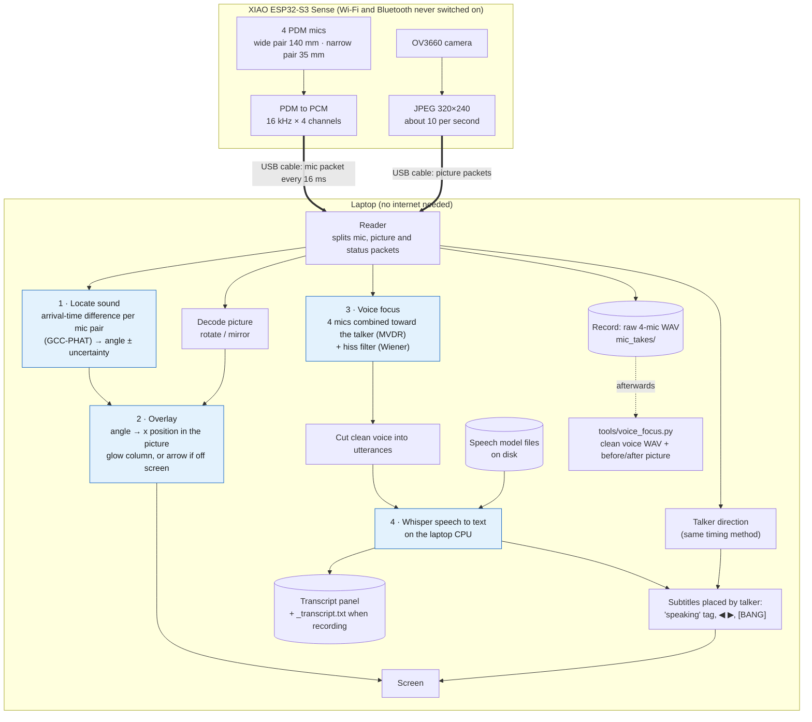
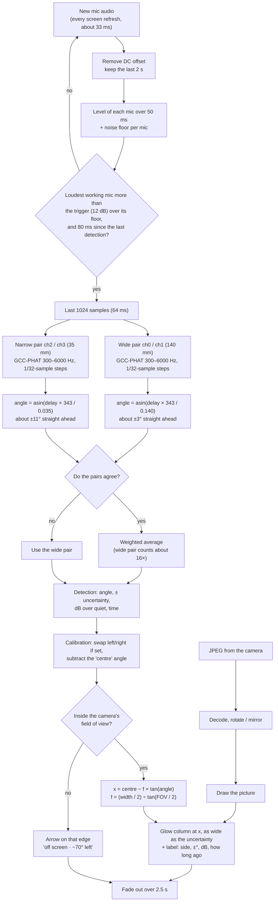
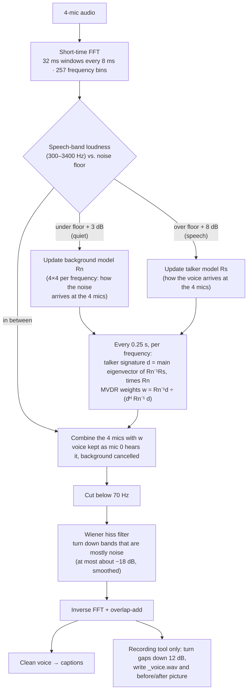
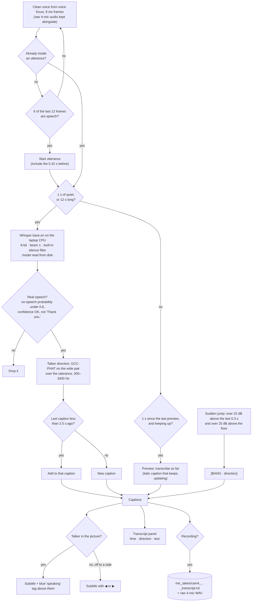
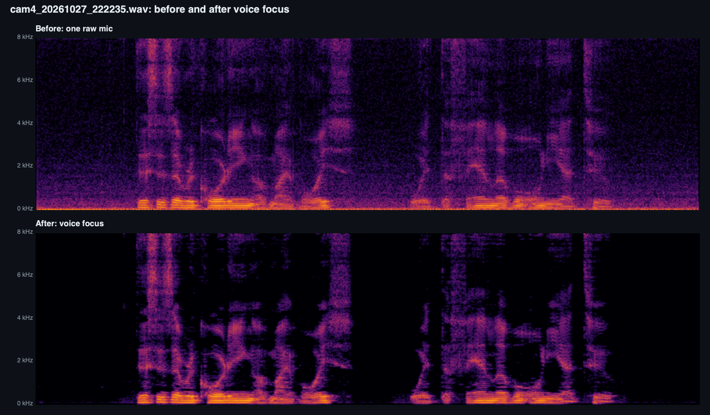
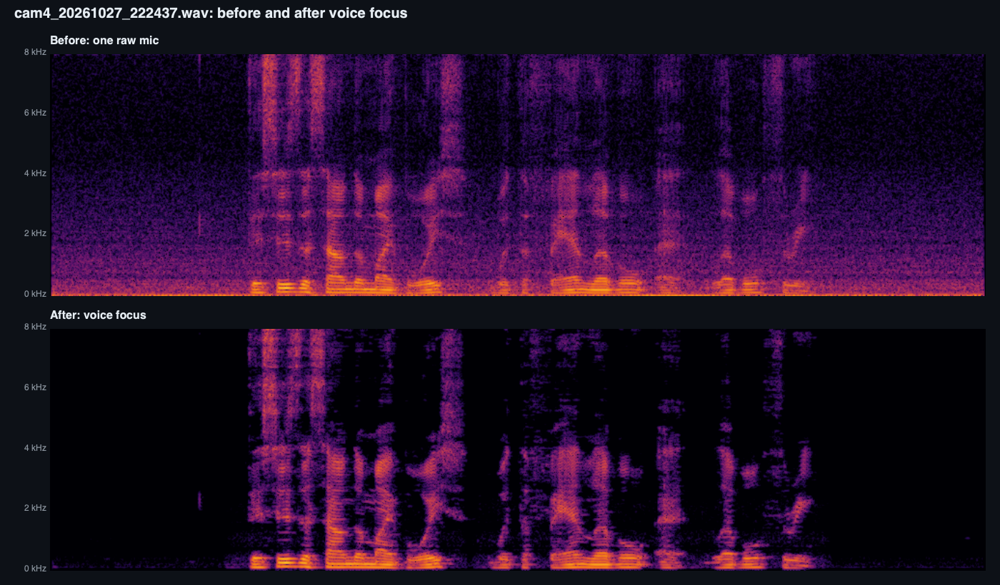
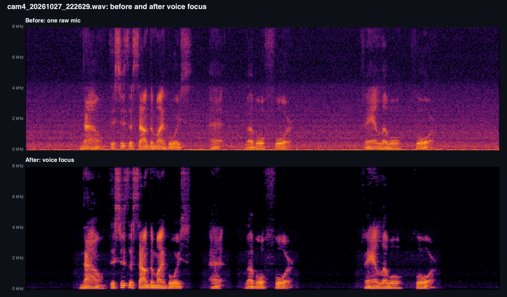
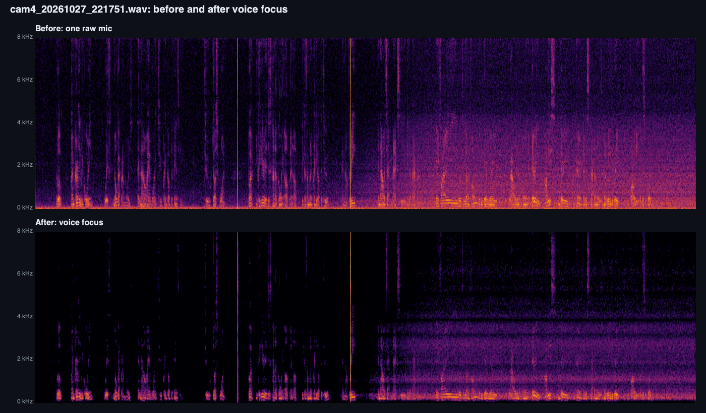

# ESP32-S3 mic array + camera: sound direction, voice focus and offline captions

A XIAO ESP32-S3 Sense with four PDM microphones and its camera, streaming over one USB
cable to a laptop. The laptop:

1. **Locates sounds**: works out which direction each loud sound came from by timing
   when it reaches each microphone.
2. **Overlays that direction on the live video**: a glowing column where the sound is in
   the picture, or an arrow on the edge when it's off screen.
3. **Enhances the voice**: combines the four mics so the talker comes through and steady
   background noise (a fan, a vent) is cancelled, then removes the leftover hiss.
4. **Writes live subtitles and a transcript**: speech to text on the laptop itself, with
   each caption placed by where the talker is.

Everything runs on the board and the laptop; **nothing goes over the internet**. See
[Offline](#offline) below and the full proof in [`CAMERA_AND_CAPTIONS.md`](CAMERA_AND_CAPTIONS.md).


## Contents

- [Flow chart: the whole system](#flow-chart-the-whole-system)
- [Hardware](#hardware)
- [1. Locating sound](#1-locating-sound)
- [2. Overlaying the direction on the video](#2-overlaying-the-direction-on-the-video)
- [3. Voice enhancement (voice focus)](#3-voice-enhancement-voice-focus)
- [4. Offline subtitles and transcript](#4-offline-subtitles-and-transcript)
- [Offline](#offline)
- [Measured results](#measured-results)
  - [Fan test at levels 2, 3 and 4](#fan-test-voice-focus-at-fan-levels-2-3-and-4)
  - [When the noise changes during a recording](#when-the-noise-changes-during-a-recording)
- [Files](#files)
- [Running it](#running-it)
- [Limits and next steps](#limits-and-next-steps)

## Flow chart: the whole system

PNG copies of every chart in this file are in [`docs/`](docs/) (`readme_flow_*.png`) for slides.



The four blue boxes are the four parts explained below.

## Hardware

| Part | Detail |
|---|---|
| Board | Seeed XIAO ESP32-S3 Sense (8 MB PSRAM), parts list in [`BOM.md`](BOM.md) |
| Mics | 4 PDM MEMS mics in a straight line, sharing one clock |
| Mic clock | D1 (GPIO2) |
| Data line 0 | D0 (GPIO1): **ch0 + ch1**, the **wide pair, 140 mm** apart |
| Data line 1 | D3 (GPIO4): **ch2 + ch3**, the **narrow pair, 35 mm** apart |
| Camera | OV3660 on the Sense board's own connector (shares no pins with the mics) |
| Link to laptop | USB-C only: mics use 128 kB/s, the camera gets the rest |

Each data line carries two mics: one answers on the rising clock edge (left) and one on
the falling edge (right). The S3's I2S peripheral turns the PDM bit-streams into 16-bit
samples at 16 kHz. Firmware: [`cam_mic_stream/cam_mic_stream.ino`](cam_mic_stream/cam_mic_stream.ino).
How the firmware shares the USB link between mics and camera (and why it uses ESP-IDF's
USB driver) is in [`CAMERA_AND_CAPTIONS.md`](CAMERA_AND_CAPTIONS.md#flow-chart-3-the-firmware).

## 1. Locating sound

Code: `Model._direction()` and `gcc_phat()` in [`mic_camera_view.py`](mic_camera_view.py).

### The idea: a sound reaches the nearer mic first

A sound from straight ahead reaches both mics of a pair at the same time. A sound from the
side reaches the nearer mic first. For two mics `d` metres apart and a sound at angle `θ`
from straight ahead:

```
delay = d × sin(θ) / c          c = 343 m/s (speed of sound)
θ     = asin(delay × c / d)
```

For the 140 mm pair the largest possible delay (sound from fully to the side) is
0.140 / 343 = 408 µs, which is only **6.5 samples** at 16 kHz. Whole samples would give
steps of 9° or more, so the delay has to be measured to a fraction of a sample (below).

### When it measures

Every screen refresh (about every 33 ms) the viewer takes the new audio and:

1. Removes each mic's DC offset and keeps the last 2 s.
2. Measures each mic's level over the last 50 ms and tracks a **noise floor** per mic
   (it drops quickly to the quiet level and creeps up slowly, so a long sound doesn't
   become the new "quiet").
3. Marks a mic **dead** if its signal hasn't moved in 0.5 s (unplugged or broken), and
   leaves it out.
4. Measures a direction only if the loudest working mic is more than the **trigger**
   (default 12 dB, slider 4–30 dB) above its floor, and at most every 80 ms.

### Measuring the delay: GCC-PHAT

For each pair, on the last 1024 samples (64 ms):

1. FFT both mics and multiply one by the conjugate of the other (the cross-spectrum).
   A delay between the mics shows up as a phase that grows steadily with frequency.
2. **PHAT weighting**: divide by its own magnitude so every frequency counts equally.
   Without this, loud low-frequency rumble and room echo dominate and the peak goes blurry.
3. Keep 300–6000 Hz only (low frequencies are mostly rumble and carry little timing
   detail across a short pair; the top of the band is mostly mic hiss).
4. Inverse FFT at **32× the length**. This gives the cross-correlation sampled every
   1/32 of a sample (2 µs), so the delay can be read between samples.
5. Search only the delays that are physically possible (± spacing / c, plus 2 samples)
   and take the highest peak. That's the delay; `asin` turns it into an angle.

### Combining the two pairs

Both pairs measure the same angle, but not equally well. The wide pair has 4× the delay
for the same angle, so the same timing error gives 4× less angle error. The viewer
assumes a timing error of about 20 µs per pair (typical on a clap) and turns it into an
angle uncertainty, which grows toward the sides (the `sin` curve flattens there):

| Sound at | Wide pair (140 mm) | Narrow pair (35 mm) |
|---|---|---|
| Straight ahead | ±2.8° | ±11° |
| 30° to the side | ±3.2° | ±13° |
| 60° to the side | ±5.6° | ±22° |

These are estimates from that assumed timing error, not a measurement. Then:

- If the two pairs **agree** (within twice their combined uncertainty + 5°), the result
  is their weighted average, each weighted by 1 / uncertainty², so the wide pair counts
  about 16× more. The narrow pair mainly acts as a check.
- If they **disagree**, the wide pair is used. (Disagreement can mean an echo, or two
  sounds at once.)
- If a mic of one pair is dead, the other pair is used alone.

Each detection is kept with its angle, ± uncertainty, how far above quiet it was (dB),
and the time.

### What a straight line of mics can't tell

- **Front or back:** a sound 30° left in front and 30° left behind give the same delays.
  The viewer says "or behind, at the mirror spot".
- **Height:** a sound at head height and one at the floor in the same direction look the
  same, so the overlay is a full-height column, not a spot.

Both are solved by adding mics off the line (see [next steps](#limits-and-next-steps)).

## 2. Overlaying the direction on the video

Code: `View.draw_camera()` and `draw_edge_arrow()` in [`mic_camera_view.py`](mic_camera_view.py).

### The picture

The board sends JPEG frames (320×240 at about 10 per second by default; 640×480 or
800×600 can be picked in the viewer). The viewer decodes the newest frame and rotates
and/or mirrors it to match how the camera is mounted. On the bench rig it's turned
90° counter-clockwise. These settings are saved between runs.

### Angle to position in the picture

The camera is treated as a simple pinhole camera. If the picture is `W` pixels wide and
the camera sees `FOV` degrees across, the camera's focal length in pixels is:

```
f = (W / 2) / tan(FOV / 2)
x = centre_x − f × tan(angle)          (+ angle = left, so it moves left of centre)
```

`tan` rather than a straight proportion because things near the edges of a picture are
stretched. A sound at half the field of view lands exactly on the edge.

### Calibration (two claps)

The mics and the camera are never perfectly lined up, so two settings correct for it:

| Setting | How to set it | What it fixes |
|---|---|---|
| **Centre** | Clap straight in front of the camera, press **Set centre** | The angle the mics report for the middle of the picture is subtracted from every detection |
| **Field of view** | Clap at the right edge of the picture, press **Set right edge** | Twice that angle becomes `FOV` (default 60°) |
| **Swap left/right** | Tick it if sounds appear on the wrong side | Flips the sign of the angle (the mic line is mounted the other way round) |

A ruler with 10° ticks along the bottom of the picture shows the result.

### What gets drawn

- **In the picture:** a glowing column at `x`. Its width is the ± uncertainty turned into
  pixels (at least 18 px), so a precise detection is a thin bright line and a rough one is
  a wide soft band. Orange normally, red when it's over 30 dB above quiet ("LOUD").
  A label next to it says the side and angle, ±°, how loud, and how long ago.
- **Off screen:** an arrow on the left or right edge, "off screen · ~70° left · turn left
  to see it". If the uncertainty band reaches into the picture it says "probably just off
  screen".
- Each detection **fades out over 2.5 s**. The most recent is bright, and older ones stay
  faintly visible so you can see a moving source's trail.
- The side panels show the same detections on a half-circle gauge, the level of each
  mic, and the stream status.



## 3. Voice enhancement (voice focus)

Code: [`tools/voice_focus.py`](tools/voice_focus.py) (for a recording) and `StreamingFocus`
in [`mic_caption_view.py`](mic_caption_view.py) (live, feeding the captions; the **Voice
focus** checkbox turns it on and off).

The idea: the voice and the background noise arrive at the four mics in different ways
(different directions, so different small delays and level differences between mics).
If we learn both patterns, we can find weights for the four mics that **add up the voice
and cancel the noise**. This needs no mic positions; it learns them from the sound.

### Step by step

1. **Short-time FFT.** The audio is cut into 32 ms windows (512 samples) every 8 ms
   (128 samples), with a square-root Hann window, giving 257 frequency bins per window.
   Everything below happens separately in each bin.
2. **Find the voice.** Loudness in the speech band (300–3400 Hz) is compared with a
   noise floor:
   - more than floor + 8 dB → **speech**;
   - less than floor + 3 dB → **quiet** (background only);
   - in between → used for neither, to keep the two models clean.
3. **Learn the background.** In quiet frames, the 4×4 **noise covariance** `Rn` is
   updated per frequency. This captures how the background shows up at each mic and how
   the mics relate (for a fan: a fixed delay pattern from its direction; for mic hiss:
   independent at each mic).
4. **Learn the talker.** In speech frames, the same for the voice (`Rs`).
5. **Find the talker's "signature" `d`.** The strongest component of the speech that
   isn't explained by the noise: the main eigenvector `v` of `Rn⁻¹·Rs` (a generalised
   eigenvector), then `d = Rn·v`, scaled so mic 0's entry is 1. `d` says how the voice
   at each mic relates to the voice at mic 0. That's the direction, learned without any
   geometry, and it includes the echoes of the room.
6. **MVDR beamformer.** Per frequency, the weights

   ```
   w = Rn⁻¹·d / (dᴴ·Rn⁻¹·d)
   ```

   are the ones that keep the voice **exactly as mic 0 hears it** (no distortion) while
   making the total background as small as possible. Four mics can cancel up to three
   separate noise sources. The output is one channel: `Y = Σ conj(w) × mic`.
7. **Cut below 70 Hz** (handling noise and rumble, no speech there).
8. **Wiener hiss filter.** Each mic's own electronic hiss is random and different at
   each mic, so the beam can't cancel it. A decision-directed Wiener filter estimates,
   per frequency and frame, how much of the output is voice vs. noise and turns the
   noisy bands down. It's smoothed over time (98% previous / 2% new) so it doesn't make
   "musical" warbling, and it never turns a band down by more than about 18 dB.
9. **Back to audio** by inverse FFT and overlap-add.

### Live vs. recording

| | Live (`mic_caption_view.py`) | Recording (`tools/voice_focus.py`) |
|---|---|---|
| Background / talker models | Running averages: background forgets over about 0.8 s, talker over about 0.4 s | Averaged over the whole file |
| Mic weights | Recomputed every 0.25 s | Once |
| Start-up | Plain average of the 4 mics until it has heard 0.8 s of quiet and 0.25 s of speech | Needs some of each in the file |
| Extra | — | Turns the gaps between words down a further 12 dB (`--gate-db`) |
| Output | Feeds the captions | `*_voice.wav`, `*_mic.wav` (one raw mic, for comparison), `*_voice.png` |

Because the live version keeps learning, it **follows a changing background**: a fan
switching on, a truck going past, or the wearer turning around takes a second or two
to adapt to.




Top: one raw mic (fan rumble along the bottom, hiss everywhere). Bottom: after voice
focus, with background down from −58 to −78.5 dBFS.

## 4. Offline subtitles and transcript

Code: `Captioner`, `angle_of()` and `CaptionView` in [`mic_caption_view.py`](mic_caption_view.py).

### Speech to text on the laptop

- **Model:** OpenAI's Whisper, run with `faster-whisper` (CTranslate2), `base.en`,
  8-bit weights, on the CPU. `--model small.en` is more accurate and slower.
- **Offline loading:** the model is loaded with `local_files_only=True`, so it reads from
  `~/.cache/huggingface/` and never contacts a server. Only if it's not there (first
  run on a new computer) does it download it once. Hugging Face telemetry is switched off.
- **Settings:** English only, beam size 1 (fastest), Whisper's built-in silence filter
  (Silero VAD, which ships inside the package) on, and no "previous text" carried
  between utterances (stops one mistake from repeating).
- **Speed:** on an Apple M2, 13.8 s of speech is transcribed in 0.6 s.

### Cutting speech into utterances

The clean voice from voice focus comes in 8 ms frames, each marked speech or quiet.

1. **Start:** when 6 of the last 12 frames (about 0.1 s) are speech. The 0.32 s just
   before is included so the first syllable isn't cut off.
2. **Preview:** every 1 s while someone is talking (once the utterance is over 0.8 s,
   and only if the laptop is keeping up), what's been said so far is transcribed and
   shown as an *italic* caption that keeps updating.
3. **End:** after 1 s of quiet, or at 12 s (long speech is split so captions don't lag).
   The whole utterance is transcribed again for the final text, which replaces the preview.

### Throwing out false captions

Whisper sometimes "hears" words in noise (famously "Thank you."). A segment is kept
only if Whisper's own **no-speech probability** is under 0.6 and its **average
confidence** (log-probability) is above −1.0. Whole results that are just a known false
phrase ("Thank you.", "Thanks for watching!", "you", …) are dropped.

### Placing the caption by who's talking

- **Talker direction:** the same timing method as part 1, on the wide pair, but over the
  raw audio of the **whole utterance** (up to its last 4 s) and only in the speech band
  (300–3400 Hz). Averaging over seconds of speech is much steadier than one 64 ms clap.
- **In the picture:** a blue **"speaking"** tag is drawn above the talker, at the same
  `x = centre − f × tan(angle)` position as the sound overlay.
- **Off screen:** the subtitle gets a **◀** or **▶** on the side the talker is.
- **Subtitle area:** the last two captions (each shown for up to 9 s) plus the live
  preview, centred along the bottom of the picture on a dark band.
- **Joining sentences:** if a new caption comes within 2.5 s of the last one (a short
  pause mid-sentence), it's added to the same line instead of starting a new one.
- **Sudden loud sounds:** a red **[BANG · direction]** line, like TV captions, when the
  sound jumps over 22 dB above the last 0.3 s and is over 25 dB above the floor. (It
  reacts to any sudden loud sound, claps included; it doesn't identify what the sound is.)

### Transcript

- The **Transcript** panel lists every caption with its time and direction
  ("21:03:12 · 34° left (off screen)").
- **Record** saves the raw 4-mic audio (`mic_takes/cam4_<date>_<time>.wav`) and, next to
  it, `cam4_<date>_<time>_transcript.txt`, one line per caption, written as it happens:

  ```
  21:03:12 (+34° mic angle) I am recording an audio right now with a fan blowing at max speed on the left.
  21:03:19 (-20° mic angle) [BANG]
  ```

  (Example lines; the format is `time (angle) text`.)

  The angle is the raw mic angle (+ = toward the ch0 side), before the camera calibration.
- Because all four raw channels are kept, a recording can be cleaned again later with
  `tools/voice_focus.py`.



## Offline

| Part | Runs on | Internet |
|---|---|---|
| Mics, camera, firmware | ESP32-S3 | None. Wi-Fi and Bluetooth are never started; data leaves only over USB. |
| Sound location, overlay | Laptop | None |
| Voice focus | Laptop | None (numpy math, no model) |
| Speech to text | Laptop CPU | None after setup (model read from disk) |
| Recordings, transcripts | Laptop disk (`mic_takes/`) | None |

Checked: while captioning, `lsof -i` showed **no network sockets** for the viewer, and the
model loads with `HF_HUB_OFFLINE=1`. The internet is needed **once per computer**, to
install the Python packages and download the speech model (about 150 MB). Details and
the firmware flow chart: [`CAMERA_AND_CAPTIONS.md`](CAMERA_AND_CAPTIONS.md).

## Measured results

Desk test, talking near the board with a fan at full speed off to the left.

| Measurement | Result |
|---|---|
| Camera frame rate | 10 fps at 320×240, 7 fps at 640×480 |
| Mic data lost while streaming the camera | 0 packets |
| Fan direction found from the recording | 30–40° left, steady the whole time |
| Background, one raw mic → after voice focus | −58 dBFS → −78.5 dBFS |
| Voice-to-background | 12 dB → 29 dB (**+17 dB**; the 4-mic beam alone gives +5.4 dB) |
| Whisper `base.en` on an Apple M2 | 13.8 s of audio in 0.6 s |
| Caption delay | about 1–2 s after the words |
| Transcript of the test clip | "I am recording an audio right now with a fan blowing at max speed on the left." (word for word) |

### Fan test: voice focus at fan levels 2, 3 and 4

Talking straight at the board (+2°) with a fan running at a fixed speed, one short
recording per fan level. Each was run through `tools/voice_focus.py` and the cleaned voice
through the same offline Whisper `base.en` model. The before/after pictures and transcripts
are in [`docs/results/`](docs/results/).

| Fan level | Raw background | Voice-to-background, raw → cleaned | 4-mic beam alone | Hiss filter + gaps | **Total** |
|---|---|---|---|---|---|
| 2 | −61.1 dBFS | 9.5 dB → 43.4 dB | +13.4 dB | +20.5 dB | **+33.9 dB** |
| 3 | −60.9 dBFS | 11.7 dB → 35.6 dB | +9.9 dB | +14.0 dB | **+23.9 dB** |
| 4 | −57.8 dBFS | 12.8 dB → 33.2 dB | +7.3 dB | +13.1 dB | **+20.4 dB** |

| Fan level | What Whisper wrote (cleaned voice) |
|---|---|
| 2 | "This is a recording of my voice with the fan level Onia 2" ("on a 2") |
| 3 | "This is the sound of my voice with the fan level at level 3" |
| 4 | "Now this is the sound of my voice at level 4. Fan level 4." (the live caption during recording said the same, see [`fan4_transcript.txt`](docs/results/fan4_transcript.txt)) |

**Fan level 2**



**Fan level 3**



**Fan level 4**



What the pictures show: at level 4 the fan fills everything up to 4 kHz, right where
speech is. After voice focus the gaps between words are dark and the speech patterns
(the curved bands at 1–4 kHz) are untouched; a faint hum is left under the words at
0–1 kHz.

What the numbers show: the faster the fan, the less the 4-mic beam alone removes (+13 →
+10 → +7 dB). A faster fan moves more air and its noise reflects off the walls, so it
arrives from more directions, and four mics can only cancel a few directions at once.
More mics (the planned 8) are the fix for this.

### When the noise changes during a recording

A 52 s recording where the fan starts off and is turned up step by step to full speed
([live transcript](docs/results/fan_ramp_transcript.txt)):



The first half (fan off or low) comes out clean, but from about 25 s, when the fan is
loud, a band of fan noise is left from 0 to 4 kHz. `tools/voice_focus.py` learns the
background once from the quietest parts of the whole file, which here are all from
before the fan was loud. The live voice focus in `mic_caption_view.py` keeps relearning
the background, so it follows this kind of change; making the file tool relearn every
few seconds is a planned improvement. The live captions during this recording were
correct apart from "crank up the fancy" (fan speed).

## Files

| File | What it is |
|---|---|
| `cam_mic_stream/` | 4 mics + camera over USB (bench pinout: clock D1) |
| `cam_mic_record/` | 4 mics + camera, plus the record button and microSD takes (FreeRTOS tasks) |
| `cam_mic_record_array4/` | Same, on the vest pinout (clock D0, data D1 + D3) |
| `cam_mic_record8/` | **Current firmware:** 8 channels on 4 data lines (D1, D3, D4, D5) + camera + SD |
| `eight_mic_stream/` | 8 channels over USB, no camera (bring-up and mic testing) |
| `mic_camera_view.py` | Camera + sound direction viewer |
| `mic_caption_view.py` | Everything above + live voice focus + offline captions and transcript |
| `mic_camera_view360.py` | 360° direction (SRP-PHAT over every mic pair) + camera, for `cam_mic_record8` |
| `array_5mic_rear_centre.json` | Mic positions for the current 5-mic test array (`--geometry`) |
| `tools/voice_focus.py` | Cleans a saved 4-mic recording down to the voice |
| `tools/sd_import.py`, `tools/take_viewer.py` | Process microSD takes (directions, voice focus, transcript, MP4) and review them |
| `tools/mic_test_ui.py`, `tools/eight_mic_capture.py` | Live one-mic-at-a-time checker and 8-channel capture |
| `tools/make_mic_test_wiring.py`, `tools/make_mic_array_wiring.py` | Generate the breadboard wiring diagrams (`mic-test-wiring.*`, `mic-array-6-wiring.*`) |
| `CAMERA_AND_CAPTIONS.md` | Firmware flow, USB packet format, offline proof |
| `docs/` | Screenshots and PNG copies of the flow charts |
| `docs/results/` | Fan test before/after pictures and transcripts |
| `four_mic_stream/`, `mic_live_view4.py` | Earlier 4-mic firmware and viewer (no camera) |
| `two_mic_stream/`, `mic_live_view.py`, `two_mic_bench_wiring.*` | First 2-mic bench rig |
| `mic_wiring_check/`, `mic_pin_finder/`, `mic_level_test/` | Wiring and mic test sketches |
| `tools/four_mic_capture.py`, `two_mic_capture.py`, `noise_compare.py`, `live_mic_ui.py` | Capture and test scripts |
| `pwm_speaker_test/`, `vest_rtos_skeleton/` | Speaker test and the vest firmware skeleton |
| `BOM.md` | Parts list |
| `mic_takes/` | Recordings, transcripts and snapshots (not in git) |

## Running it

**Firmware** (Arduino ESP32 core; "USB CDC On Boot" must be disabled, which is the
`CDCOnBoot=cdc` option):

```
cd esp32s3
arduino-cli compile --fqbn esp32:esp32:XIAO_ESP32S3:PSRAM=opi,CDCOnBoot=cdc cam_mic_stream
arduino-cli upload  --fqbn esp32:esp32:XIAO_ESP32S3:PSRAM=opi,CDCOnBoot=cdc -p <port> cam_mic_stream
```

**Laptop** (both viewers find the board on their own and set up their Python packages
on the first run):

```
python3 mic_camera_view.py        # camera + sound direction
python3 mic_caption_view.py       # + voice focus, subtitles and transcript
python3 mic_caption_view.py --model small.en      # more accurate captions, slower
~/.mic-live-view-env/bin/python tools/voice_focus.py mic_takes/<recording>.wav
```

Without a board: `python3 mic_caption_view.py --demo-wav mic_takes/<recording>.wav --demo-image photo.jpg`.

First time with a new camera mount: pick the rotation, clap straight ahead → **Set
centre**, clap at the right edge of the picture → **Set right edge**.

## Limits and next steps

**Limits now**

- Left/right only: no front/back and no height (mics in one line).
- One talker at a time; voice focus aims at the main voice by itself (aiming it by hand
  isn't built).
- Noise from all around (crowds, wind, echoey rooms) is reduced less than noise from
  one direction. Wind needs foam covers on the mics.
- Captions trail speech by 1–2 s and can get words wrong, especially with distance,
  accents or shouting. This is a prototype, not a certified accessibility device.

**Next steps**

- **Four more mics (8 total)** on two more data lines (D4, D5), placed off the current
  line so the array is 2-D. That gives front/back, and, with mics at different heights,
  up/down. USB has room for it (8 mics = 256 kB/s).
- **Better location accuracy:** use every mic pair together (SRP-PHAT: try every
  direction and pick the one all pairs agree on best) instead of two pairs, measure the
  exact mic positions, calibrate each mic's delay, and track sources over time so the
  overlay is steadier.
