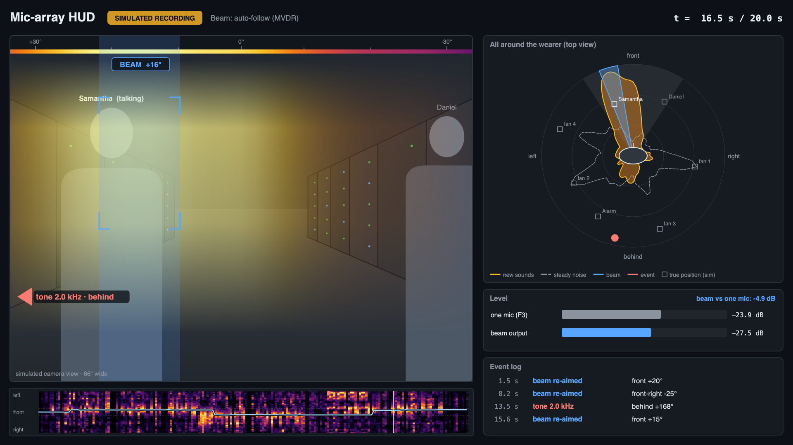

# Mic-array HUD prototype

A heads-up display for the wearable mic array. It shows where sound is coming from, where the beam is pointed, and lets you click a person to hear the recording re-aimed at them.

It runs on a **simulated** 8-mic shirt recording today. The same code takes a real recording (plus optional camera video) once the array is built.



## What's on screen

1. **Camera view with sound heat.** Brighter columns mean more new sound from that direction. A compass tape along the top gives the angle.
2. **Beam marker.** The blue band and `BEAM +16°` tag show where the beam is pointed.
3. **Edge arrows.** Sounds outside the camera's view appear as arrows on the left or right edge. Lower on the edge means further behind. Red arrows are detected events.
4. **Top-view radar.** All 360° around the wearer:
   - orange: new sounds (talkers, events)
   - dashed grey: steady noise (fans)
   - blue: the beam
   - squares: true positions (simulation only)
5. **Direction-over-time strip.** Time runs left to right; front is in the middle, left at the top, right at the bottom. The light-blue line is the beam, and red dots are events. This is the fastest way to see who spoke from where.
6. **Level meters and event log.** These show one mic versus the beam output, plus a log of alarms and beam re-aims.

## Run it

Needs a Python environment with numpy, scipy, pyroomacoustics and PySide6, plus `ffmpeg` (Homebrew). The commands below assume it's at `~/.venvs/mic-hud`.

```bash
cd hud
PY=~/.venvs/mic-hud/bin/python

$PY simulate.py          # makes sim/recording.wav etc. (about 10 s)
$PY hud.py render        # out/hud_auto.mp4 (with beam audio), WAVs, PNG stills
$PY hud.py view          # interactive window: click a person or a radar direction to listen there
$PY hud.py eval          # simulation only: direction accuracy and dB gains -> out/sim_results.json
$PY hud.py render --steer -30   # fixed beam instead of auto-follow (+ = wearer's left)
$PY hud.py render --beam das    # plain delay-and-sum instead of the adaptive (MVDR) beam
```

In `view`, the controls are:
- **Play:** plays the beam audio.
- **Auto-follow:** goes back to automatic steering.
- **Beam menu:** switches between MVDR and delay-and-sum.
- **Slider:** scrubs through the recording.

Clicking re-computes the beam for the whole recording in under a second.

Compare `out/mic_F3.wav` (one mic) with `out/beam_auto.wav` (beam) to hear the difference.

## Standalone version (any Mac, nothing to install)

`out/mic-hud-standalone.html` (built by `export_html.py`, below) is one ~7 MB file that holds the whole HUD: the 8-channel recording, the direction maps and the beamformer (in JavaScript). Copy it to another Mac by AirDrop, USB stick or email, and double-click it to open it in Safari or Chrome. No Python and no internet needed.

It does everything `hud.py view` does:
- click a person or a radar direction to steer the beam
- auto-follow
- switch between the adaptive (MVDR) and delay-and-sum beams
- scrub the timeline

It also has a **Listen: beam / one mic** switch to compare the two while it plays. Keys: `space` play/pause, `←`/`→` step, `A` auto-follow, `M` beam/one mic.

Rebuild it after changing the simulation or the HUD code (this only needs numpy and scipy):

```bash
$PY export_html.py
$PY export_html.py --recording my_take.wav --geometry my_geometry.json --scene none \
    --video phone.mp4 --video-offset 2.35 --hfov 66      # real recording, video embedded
```

The browser code is in `web/` (`dsp.js` is the beamformer, `hud.js` the drawing and controls, `template.html` the page). The JavaScript beamformer gives the same output as `hud_core.beamform` to about 1 part in 10⁸.

## Using a real recording

```bash
$PY hud.py render --recording my_take.wav --geometry my_geometry.json \
    --video phone.mp4 --video-offset 2.35 --hfov 66 --scene none
```

- **Recording:** a 16-bit multichannel WAV, one channel per mic, all from the same board (one shared clock).
- **Geometry:** copy `sim/geometry.json` and edit it.
  - Mic order must match the channel order in the WAV. On the ESP32-S3, tap each mic once to confirm the order.
  - Positions are in metres from the chest centre: x forward, y to the wearer's left, z up.
- **Video offset:** the number of seconds into the video where the audio recording starts. Clap once at the start of every take and line up the clap.
- **`--hfov`:** the camera's horizontal field of view. About 66° for the XIAO Sense camera; check your phone's.
- **`--yaw`:** use this if the camera doesn't point straight ahead. One clap from straight in front of the camera tells you the offset.

## How it works

- **Direction finding (SRP-PHAT).** For each 0.1 s frame, the code steers to 144 directions and measures how well the mics line up in each.
  - Only time-frequency bins at least 6 dB above each frequency's steady noise floor count.
  - That keeps steady fans from swamping talkers and events.
  - The fans show up separately as the dashed "steady noise" outline.
- **Beam.** An MVDR beam designed against spread-out (diffuse) noise. Plain delay-and-sum is also available with `--beam das`. The beam is re-aimed every 0.1 s along the track.
- **Auto-follow.** Locks onto the strongest new sound inside the camera view. It only switches target after a new direction wins three frames in a row, so it doesn't jitter.
- **Events.** A new sound that persists for two frames and comes from a fresh direction. "tone 2.0 kHz" vs "voice / broadband" is a crude spectral label standing in for a trained classifier.

## Simulated results (`hud.py eval`)

The scene is a 10 × 7 m server aisle, with:
- reverberation time (RT60) of 0.5 s
- Samantha talking at +20° and 1.5 m
- Daniel talking at −30° and 2 m
- a beeping alarm behind-left at +150°
- four rack fans at the sides and behind
- talker-to-fan ratio of −3 dB at one mic

| Beam on Samantha | Daniel | Fans | Alarm |
|---|---|---|---|
| Adaptive (MVDR) | −5.7 dB | −4.1 dB | −2.5 dB |
| Delay-and-sum | −1.5 dB | −2.2 dB | −4.6 dB |

All values are relative to Samantha (0 dB).

- The tracked beam angle settles at about 18–19° for Samantha (truth 20°) and about −25° for Daniel (truth −30°).
- Single-frame direction estimates are noisier: the median error is 7.5° (Samantha) and 12.5° (Daniel).
- The alarm is detected as "tone 2.0 kHz, behind" at about 168° (truth 150°). The wide back pair makes 2 kHz ambiguous.

**Caveats.**
- This is a free-field room simulation: the wearer's body isn't modelled, so rear mics hear front talkers without the torso blocking them.
- The mics are perfectly matched and never move.

Real gains will differ. Treat these numbers as "the pipeline works", not as a performance claim.

## Files

| File | What it is |
|---|---|
| `simulate.py` | Builds the simulated scene. Talkers are macOS `say` voices |
| `hud_core.py` | Direction finding, beamformers, auto-follow, event detection (numpy/scipy only) |
| `hud_render.py` | Draws a HUD frame with Qt (works without a display) |
| `hud.py` | Command line: `render`, `view`, `eval` |
| `export_html.py` | Builds the standalone `out/mic-hud-standalone.html` |
| `web/` | Browser version: `dsp.js`, `hud.js`, `template.html` |
| `sim/` | Mic geometry, ground-truth scene and talker voices; `simulate.py` writes the recording here |
| `out/` | Videos, WAVs, stills and `sim_results.json` from `hud.py`; only two stills and the results are checked in |
